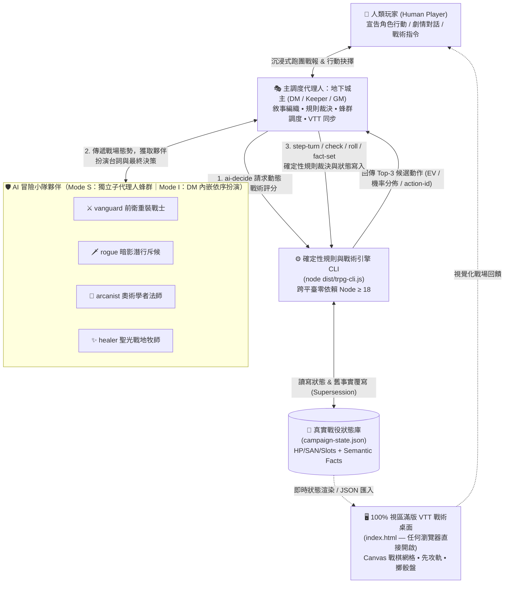

# 跨平臺跨代理人：多子代理人 TRPG 地下城主與 AI 夥伴跑團引擎 (`trpg-swarm`)

歡迎啟動 **`trpg-swarm`**！本技能將宿主代理人（Host Agent）轉化為全知全能的 **地下城主 / 守密人 / 遊戲主持人（DM / Keeper / GM）**，並依宿主能力組建 **4 名性格鮮明、具備獨立戰術大腦的 AI 冒險夥伴**（獨立子代理人蜂群，或單一上下文內的多重角色扮演），結合底層純確定性規則與戰術評估 CLI（`dist/trpg-cli.js`，零依賴、Node ≥ 18、Windows/macOS/Linux 通用）以及 100% 視區滿版虛擬戰術桌面（`index.html`），為人類玩家提供零幻覺、高沉浸感、數據嚴密對齊的頂級跑團體驗。

---

## 核心黃金準則（Core Directives）

1. **禁止心算擲骰與口頭捏造狀態**：所有擲骰檢定、傷害結算、理智（SAN）扣減、法術位消耗、先攻輪替與世界事實變更，**必須**透過終端機執行 `node dist/trpg-cli.js`（見「跨平臺執行環境」），並以 `./campaign-state.json` 為唯一真實來源（Single Source of Truth）。
2. **禁止固定常數戰術評分（Anti-Slop Dynamic Tactical AI）**：AI 夥伴與敵方 NPC 的戰術決策必須呼叫 `node dist/trpg-cli.js ai-decide`，根據當前距離、血量比、掩體、法術資源與威脅度動態計算多維度效用函數（Utility）與 Softmax 機率分佈。
3. **依宿主能力選擇協同模式，絕不虛構工具**：先偵測自身具備的工具（見「跨代理人能力適配層」），再決定採用蜂群模式（Mode S）或單代理人扮演模式（Mode I）。**嚴禁呼叫當前環境不存在的工具名稱**；能力不足時優雅降級，而非捏造。
4. **時序語義事實覆寫（Temporal Semantic Supersession）**：世界狀態與劇情線索採用語義事實庫管理；當新事件推翻舊事實（如「石門緊鎖」變為「石門已被撞碎」），系統自動將舊事實標記為 `isActive: false` 並記錄 `supersededBy`，杜絕長戰役前後矛盾。

---

## 跨平臺執行環境（Cross-Platform Runtime）

本技能的所有指令皆為 **Windows（PowerShell / cmd）、macOS（zsh / bash）與 Linux（bash）通用**：一律以 `node dist/trpg-cli.js <command>` 形式執行，路徑使用正斜線，無需任何殼層專屬語法（沒有 `Copy-Item`、沒有管線導檔）。

執行方式依優先順序（擇一可用即可）：

| 優先順序 | 指令形式 | 需求 | 適用場景 |
| :--- | :--- | :--- | :--- |
| 1（首選） | `node dist/trpg-cli.js <command>` | Node.js ≥ 18，**免安裝、免建置、零依賴** | 預先打包好的通用執行檔，任何 OS / 任何 Node 18+ |
| 2（原始碼模式） | `node --experimental-strip-types scripts/trpg-cli.ts <command>` | Node.js ≥ 22.6 | 需要直接修改 TypeScript 原始碼時 |
| 3（npm 包裝） | `npm run cli -- <command>` | Node.js ≥ 18 | 習慣 npm 工作流時 |

開局必做的環境驗證（失敗即向使用者回報缺 Node，不要繼續空轉）：

```bash
node dist/trpg-cli.js roll "1d20"
```

> 給宿主代理人的叮嚀：以上指令在 PowerShell 中原樣可用（PowerShell 相容正斜線路徑與引號）；`--json` 旗標可取得機器可讀輸出，`--seed <num>` 可重現同一序列的骰點。

---

## 跨代理人能力適配層（Agent Capability Adapter）

本技能 **不綁定任何特定代理人的工具名稱**。啟動時，請先對照下表盤點自身能力，把「泛用能力」映射到你實際擁有的工具：

### 能力 → 工具映射表

| 泛用能力 | Claude Code | Codex CLI | Gemini CLI | Cursor | 通用 Agent 框架 |
| :--- | :--- | :--- | :--- | :--- | :--- |
| 執行終端機指令 | `Bash` | shell 工具 | `run_shell_command` | terminal / `run_command` | 任意 exec/shell 工具 |
| 讀取技能檔案 | `Read` | 讀檔工具 | `read_file` | `view_file` / 讀檔工具 | 任意檔案讀取工具 |
| 建立子代理人 | `Task` 工具 | 子代理人/多工機制 | subagent 機制 | composer/背景 agent | `define_subagent` / 任意 spawn 機制 |

### 三種運行模式（依偵測結果自動選擇最高可用模式）

| 模式 | 觸發條件 | 夥伴協同方式 |
| :--- | :--- | :--- |
| **Mode S（Swarm 蜂群）** | 宿主具備「執行指令 + 建立子代理人」兩項能力 | 以宿主的子代理人機制註冊 4 名夥伴（人設提示詞見 [子代理人協定](./references/subagent-persona-prompts.md)），DM 與夥伴各自獨立上下文，傳遞戰場快照與 Top-3 候選動作 |
| **Mode I（Inline 單代理人扮演）** | 宿主僅具備「執行指令」能力（無子代理人機制） | DM 在同一上下文中，**依序**切換 4 名夥伴的人格提示詞扮演（每名夥伴遵守 references 內的人設、戰術樹與 Banter 協定），所有規則數學仍 100% 交給 CLI —— 夥伴「人格」可內嵌，**骰子絕不內嵌** |
| **Mode M（Manual 純對話降級）** | 宿主完全無法執行終端機指令 | 明確告知使用者：確定性引擎無法運行；改以 [規則百科](./references/) 為準請人類玩家擲實體骰或任意擲骰器回報點數，DM 於對話中以 Markdown 表格追蹤 HP/SAN/事實，並標註「非確定性模式」 |

**鐵律**：模式選擇失敗不是錯誤，捏造工具呼叫才是錯誤。任何不確定，先執行環境驗證指令測試 CLI 是否可用。

---

## 核心架構圖（Multi-Agent TRPG Swarm Loop）



---

## Step 1：戰役初始化與系統選擇（Campaign Initialization）

開局時，請先詢問或確認人類玩家偏好的規則系統與劇本風格，支援三大主流系統：

| 系統代碼 (`--system`) | 規則體系 | 核心檢定機制 | 適用題材與風格 |
| :--- | :--- | :--- | :--- |
| `dnd5e` | **D&D 5e (SRD 5.1)** | `1d20 + 調整值 >= DC / AC`<br/>（支援優勢 `2d20kh1` / 劣勢 `2d20kl1`、暴擊與死亡豁免） | 史詩奇幻、地城探索、戰棋走位、頭目討伐 |
| `coc7e` | **Call of Cthulhu 7e** | `1d100 <= 技能值`<br/>（普通 / 困難 `1/2` / 極限 `1/5`、獎懲骰、理智檢定 SAN、孤注一擲與燃燒幸運） | 克蘇魯神話、懸疑調查、民俗恐怖、密室逃脫 |
| `pbta` | **PbtA (Dungeon World)** | `2d6 + 屬性調整值`<br/>（`10+` 完全成功、`7-9` 代價成功、`6-` 失敗標記 XP 並觸發 GM Hard Move） | 電影感敘事、快速推進、即興危機、高張力冒險 |

### 1.1 初始化全新戰役狀態檔

選定系統後，立即以你的終端機工具執行 `init` 建立 `./campaign-state.json`（指令三平臺通用）：

```bash
# 初始化 D&D 5e 奇幻地城戰役
node dist/trpg-cli.js init --system dnd5e --state ./campaign-state.json

# 或初始化 CoC 7e 克蘇魯調查戰役
node dist/trpg-cli.js init --system coc7e --state ./campaign-state.json

# 或初始化 PbtA (Dungeon World) 敘事冒險戰役
node dist/trpg-cli.js init --system pbta --state ./campaign-state.json
```

`init` 的輸出會直接列出 **所有可用 actor id** 與先攻順序 —— 後續所有指令的 `--actor` 請以這份清單為準。

### 1.2 載入官方範例戰役劇本（可選，跨平臺免殼層複製）

若玩家希望立即體驗完整預設劇本，使用 `init --example` 由 CLI 在程式內完成載入（**不需要 `Copy-Item` / `cp` 等殼層專屬指令**）：

```bash
# D&D 5e 範例戰役：緋紅地窖的隕落聖物
node dist/trpg-cli.js init --example crimson-crypt --state ./campaign-state.json

# CoC 7e 範例戰役：阿卡姆碼頭的星之低語
node dist/trpg-cli.js init --example arkham-shadow --state ./campaign-state.json
```

範例檔為敘事劇本格式（campaign book），`init --example` 會自動將其轉換為引擎可直接運算的 `WorldState`（戰術網格、參戰者數據、任務旗標語義事務一次到位），輸出訊息並列出所有可用 actor id 與先攻順序。

- 範例戰役完整內容：[D&D 5e：緋紅地窖](./examples/campaign-crimson-crypt.json)、[CoC 7e：阿卡姆碼頭](./examples/campaign-arkham-shadow.json)
- 範例狀態內含人類玩家角色（`player-hero` / `player-investigator`）與 4 名夥伴（`trpg-companion-vanguard` 等）。

---

## Step 2：組建 AI 夥伴小隊（依模式而定）

完整人設提示詞（背景故事、性格缺陷、三大系統屬性轉換表、戰術決策樹、輸出 JSON 契約與羈絆互動協定）模組化收納於 **[子代理人角色扮演與通訊協定](./references/subagent-persona-prompts.md)**，請以你的檔案讀取工具按需查閱。4 名夥伴概覽：

| 夥伴（戰術定位） | 角色名稱範例 | 核心職責 | 性格關鍵字 |
| :--- | :--- | :--- | :--- |
| `vanguard` 前衛重裝戰士 | 艾莉亞·凡斯 | 前排卡位、保護後排、近戰突破與戰術掩護 | 正氣凜然、重誓言、一板一眼 |
| `rogue` 暗影潛行斥候 | 洛克·ヴェーン | 側翼偷襲、陷阱偵測、高價值目標斬首與環境調查 | 機敏毒舌、計算精準、嘴硬心軟 |
| `arcanist` 奧術學者法師 | 賽拉斯·索恩 | 範圍控場、遠程法術爆發與知識檢定 | 博學傲氣、資源精算、危險好奇 |
| `healer` 聖光戰地牧師 | 萊拉·黎明 | 生命治療、濒死救援、理智恢復與防護增益 | 溫柔堅韌、同理心、團隊良心 |

- **Mode S（有子代理人機制）**：以宿主工具註冊 4 名夥伴子代理人，SystemPrompt 直接取用 references 內的 `<Persona_Definition>` 範本；DM 與夥伴間傳遞「戰場快照 + Top-3 候選動作」，夥伴回傳 `TurnResponsePayload` JSON。
- **Mode I（僅有終端機）**：DM 在同一上下文中依序套用各夥伴人格進行扮演，遵守同一份人設、戰術樹與 Party Banter 協定；差別僅在「多重上下文」變成「單一上下文多重人格」，規則數學仍全數經過 CLI。

---

## Step 3：標準回合推進循環（The Turn Loop Protocol）

在戰鬥遭遇或關鍵調查場景中，DM 必須嚴格遵循以下 **四階段回合推進循環**：

### 階段 1：情境感知與動態戰術評分（Context-Aware Tactical Evaluation）

輪到任何 AI 夥伴或敵方單位行動時，**第一步必須呼叫 `ai-decide`**，取得基於當前戰場幾何距離、血量比、資源量與威脅權重計算出的 **Softmax Top-3 戰術候選動作**：

```bash
node dist/trpg-cli.js ai-decide --state ./campaign-state.json --actor trpg-companion-vanguard --temperature 0.65
```

- **輸出內容**：每個候選動作的期望效益分數（`score`）、Softmax 選擇機率（`probability`）、各維度效用拆解，以及後續 `step-turn --action-id` 所需的 `action-id`。
- **actor id 別名容錯**：`--actor` 支援 `vanguard`、`companion-rogue`、`trpg-companion-healer` 等常見寫法自動解析；比對失敗時錯誤訊息會列出全部合法 id，依清單自我修正即可。不確定 id 時先跑 `summary`。
- **嚴格禁令**：嚴禁繞過 CLI 自行編造固定分數或隨機盲選動作。

### 階段 2：夥伴扮演與決策（Companion Roleplay & Decision）

拿到 `ai-decide` 的 Top-3 戰術分析後：

- **Mode S**：透過你的子代理人工具將戰場摘要與 Top-3 候選動作傳遞給對應夥伴（探索階段可平行喚醒 1～2 位最相關夥伴；戰鬥階段依先攻順序喚醒），收集其 `TurnResponsePayload`。
- **Mode I**：DM 切換至該夥伴人格，基於 Top-3 候選動作產生行動宣告與台詞，再切回 DM 裁決。

### 階段 3：確定性規則檢定與狀態變更（Deterministic Rule Check & State Mutation）

```bash
# 1. 執行當前角色的戰術動作並推進先攻回合（--action-id 直接複製 ai-decide 輸出的候選動作 id；省略則由 Softmax 自主選擇）
node dist/trpg-cli.js step-turn --state ./campaign-state.json --actor trpg-companion-vanguard --action-id javelin

# 2. 人類玩家的自訂行動檢定（D&D 5e 技能檢定：1d20+mod 對 DC，支援優勢/劣勢）
node dist/trpg-cli.js check --state ./campaign-state.json --dc 15 --label "Perception (player-hero)" --mode advantage --mod 3

# 2b. CoC 7e 百分骰（--skill 為 0-100 技能值；支援 --difficulty hard|extreme、--bonus 獎懲骰、--san 理智檢定）
node dist/trpg-cli.js check --system coc7e --skill 65 --difficulty hard

# 2c. 通用擲骰（支援標準骰池、高低保留與獎懲骰）
node dist/trpg-cli.js roll --expr "2d20kh1+6"

# 3. 寫入或更新世界語義事實（--value 與 --object 同義；自動將同 subject+predicate 舊事實標記 isActive: false）
node dist/trpg-cli.js fact-set --state ./campaign-state.json --subject "crypt_altar" --predicate "status" --value "unsealed_glowing_crimson"

# 4. 任何時刻的全場狀態總覽（先攻、HP/SAN/AC、座標、生效事實）
node dist/trpg-cli.js summary --state ./campaign-state.json
```

> `--action-id` 指定了該角色當前不合法的動作時，CLI 會直接報錯並列出全部合法 action id（絕不靜默改選其他動作）—— 依錯誤訊息自我修正即可。

> `check` 帶 `--state` 時會自動採用該戰役的規則系統，無需重複指定 `--system`。

### 階段 4：DM 綜合敘事與視覺化呈現（DM Synthesis & VTT Presentation）

完成 CLI 檢定與狀態寫入後，主調度 DM 將機械數據與夥伴台詞編織為結構化的沉浸式戰報：

1. **🎲 規則裁決面板**：明確列出擲骰公式、自然骰值、修正後總值、目標 DC/AC 與結果分級（如 `2d20kh1 (18, 7) + 6 = 24 vs AC 15 -> 命中！造成 11 點揮砍傷害`）。
2. **🗣️ 夥伴互動劇場**：呈現前衛、斥候、法師、牧師的角色扮演行動與對話。
3. **📊 戰場態勢摘要**：列出當前先攻順位、雙方剩餘 HP / SAN / 法術位，以及最新生效的語義事實（Active Semantic Facts）。
4. **🖥️ VTT 戰術桌面指引**：提醒玩家以瀏覽器開啟專案根目錄的 `index.html`（檔案總管雙擊；或 `open index.html` / `xdg-open index.html` / `start index.html`），即時檢視 2D 戰術網格、角色狀態卡、擲骰動畫與推進回合。

---

## Step 4：全系統參考百科與範例劇本索引（Progressive Disclosure References）

為保持上下文精煉，詳細規則公式、法術/怪物數據表、理智瘋狂症狀表與夥伴通訊模板已模組化收納於以下專文，請以你的檔案讀取工具依當前跑團需求按需查閱：

### 📚 規則百科與夥伴協定（References）
- **[D&D 5e SRD 5.1 完整規則百科](./references/dnd5e-srd-rules.md)**
  涵蓋六大屬性、優勢/劣勢、先攻與動作經濟（Action / Bonus Action / Reaction）、攻擊與暴擊、法術位環級表、狀態效果（Conditions）與死亡豁免檢定完整規範。
- **[克蘇魯的呼喚 CoC 7e 完整規則百科](./references/coc7e-rules.md)**
  涵蓋 `1d100` 成功等級（大成功 `01` / 極限 `1/5` / 困難 `1/2` / 普通 / 大失敗 `96-100`）、獎勵骰與懲罰骰十位數替換規則、孤注一擲（Pushing Rolls）、燃燒幸運（Burning Luck）以及理智檢定（SAN Check）與臨時/不定時瘋狂發作表。
- **[PbtA 地下城世界敘事規則百科](./references/pbta-dungeon-world.md)**
  涵蓋 `2d6 + Stat` 三段式結果（`10+` / `7-9` / `6-`）、基礎舉動（Hack and Slash, Volley, Defy Danger, Cast a Spell, Spout Lore, Discern Realities）以及 GM 軟招式（Soft Moves）與硬招式（Hard Moves）觸發原則。
- **[子代理人角色扮演與通訊協定](./references/subagent-persona-prompts.md)**
  涵蓋 DM 與 4 名 AI 夥伴的完整背景故事、性格缺陷、三大規則系統屬性轉換表、標準輸入/輸出 JSON 結構（`TurnResponsePayload`）與團隊衝突調解指南；同時適用於 Mode S（獨立子代理人）與 Mode I（單上下文內嵌扮演）。

### 🗺️ 預設範例戰役劇本（Examples）
- **[D&D 5e 範例戰役：緋紅地窖的隕落聖物](./examples/campaign-crimson-crypt.json)**
  4 人冒險小隊深入被死靈腐化的緋紅地窖，包含完整戰術網格座標、障礙掩體、哥布林/骷髏守衛與死靈領主頭目數據，以及初始語義事實庫。
- **[CoC 7e 範例戰役：阿卡姆碼頭的星之低語](./examples/campaign-arkham-shadow.json)**
  1920 年代阿卡姆 4 號廢棄船塢調查劇本，包含深潛者混種、星之眷族線索、理智檢定觸發器與多階段調查事實鏈。

---

## 附錄：CLI 指令速查（`node dist/trpg-cli.js <command>`）

| 指令 | 關鍵旗標 | 用途 |
| :--- | :--- | :--- |
| `init` | `--system <dnd5e\|coc7e\|pbta>`、`--example <crimson-crypt\|arkham-shadow>`、`--state <path>`、`--seed` | 初始化狀態檔 / 載入範例戰役 |
| `roll` | `"<expr>"`（如 `2d20kh1+6`、`1d100`）、`--seed` | 通用確定性擲骰 |
| `check` | `--state`（自動帶入系統）或 `--system`；dnd5e：`--dc --mod --mode --label`；coc7e：`--skill --difficulty --bonus --push --luck --san --san-loss`；pbta：`--move --mod --danger` | 規則檢定 |
| `ai-decide` | `--state --actor [--temperature] [--seed]` | Softmax Top-3 戰術候選（含 `action-id`） |
| `step-turn` | `--state [--actor] [--action-id] [--temperature]` | 執行動作並推進回合 |
| `fact-set` | `--state --subject --predicate (--value\|--object) [--category]` | 寫入/覆寫語義事實 |
| `summary` | `--state` | 全場狀態總覽（含所有合法 actor id） |

所有指令皆支援 `--json`（機器可讀輸出，供宿主代理人解析）與 `--seed`（重現確定性序列）。
